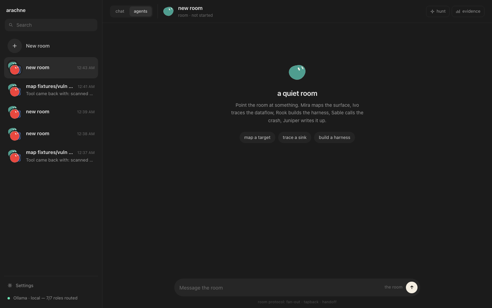
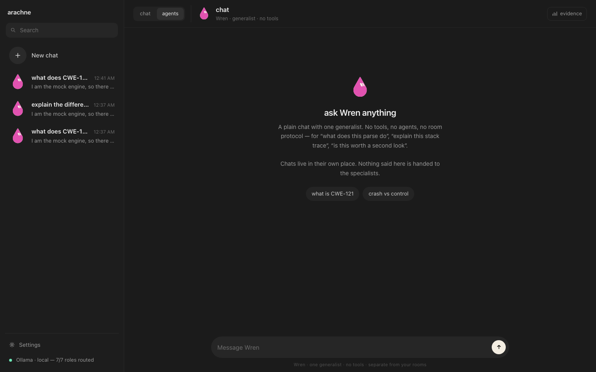
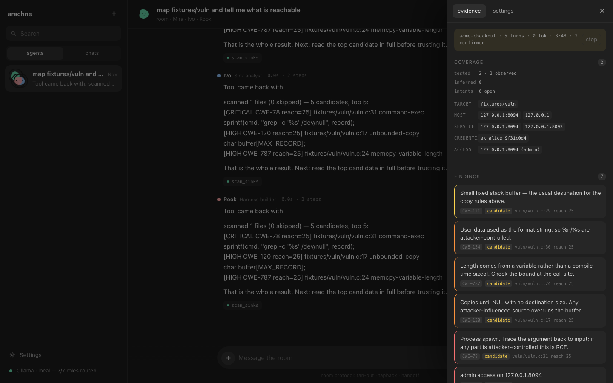
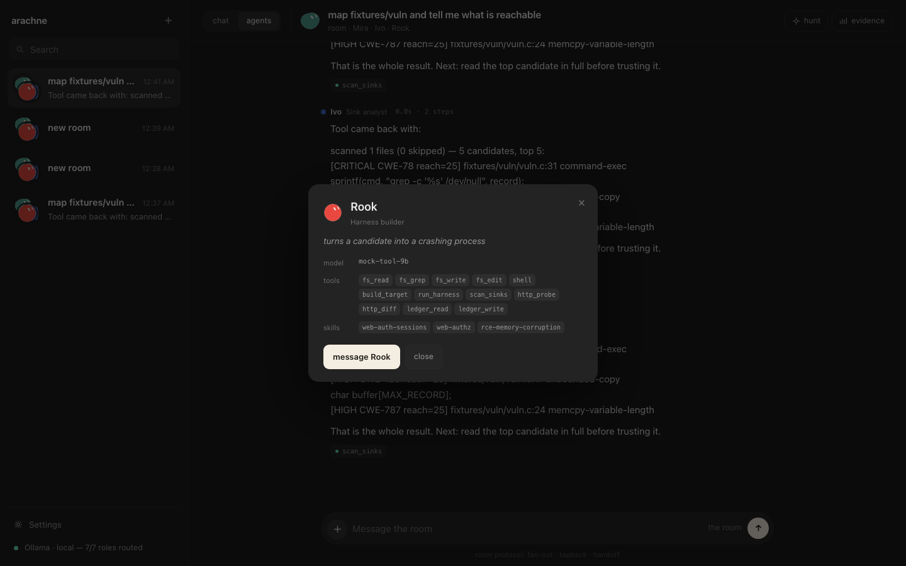

# arachne

A local agent room for RCE research. Six specialists with narrow toolbelts map a
target, trace untrusted data to dangerous sinks, build a crashing harness under
AddressSanitizer, **re-run it before believing it**, and write the report.
Alongside the room there is a plain chat for asking questions about the code.

Everything runs on your machine. No cloud, no API keys, no build step — Node 20+
and whatever local inference runtime you already have.



## How it runs

Nothing to download or install as an application. `gui/` is a **local server that
serves its own interface**: start the process, open the URL, and the browser is
the GUI. There is no build step, no bundler, no native binary, no `.dmg`.

At boot it probes each configured engine — the default is `http://127.0.0.1:11434`,
which is Ollama — asks it what models it has and what each one can do, then routes
a model to every role. Ollama models that advertise `tools` are eligible for
tool-using roles; the rest are not, because a model without a tool channel cannot
call a harness. If nothing answers, the app still starts and says so in the
bottom-left pill, and the deterministic half of the pipeline still runs.

## Run it

```bash
cd gui
node server/index.mjs          # → http://127.0.0.1:7777
```

At boot it probes every configured engine and routes a model to each role. If
Ollama is up with a tool-capable model you are done; otherwise use **refresh** in
the routing rail, or add an engine in `config.json`.

```bash
node server/selftest.mjs         # 25 checks, no model required
node server/mockengine.mjs 8099  # a fake OpenAI-compatible engine, for demos
```

The terminal client lives in the sibling `cli/` folder and talks to this server
over the same HTTP API the browser uses.

## Rooms and chats

Two separate things, with separate thread lists and separate storage:

| | rooms | chats |
|---|---|---|
| who answers | any member, or one specialist | Wren, the generalist |
| tools | yes, per agent toolbelt | none |
| protocol | fan-out, tapback, handoff | plain question and answer |
| threads | `kind: "room"` | `kind: "chat"` |

A chat thread is never handed to the agents and a room is never reused for a
question. The server enforces it: sending a chat message with a room's thread id
creates a fresh chat thread instead of mixing the two. Nothing you ask Wren can
leak into a hunt, and nothing a hunt learns shows up in your chat.

## Interface

Two columns, like a chat app rather than a dashboard:

- **chat / agents** at the top of the window is the mode switch: `chat` is a
  1:1 conversation with one generalist, `agents` is the rooms where the
  specialists work. They are separate thread namespaces, not a filter
- the left list shows whichever mode you are in, with a **New chat** or
  **New room** entry at the top — one action, and the mode decides what it makes
- the search field filters the list
- **evidence** slides over from the right — coverage, state, findings — and
  closes as soon as you go back to the conversation
- **settings** (bottom left) holds engagement, agents, skills, routing, scope and
  the tool console; none of it is visible while you are talking
- click a finding to expand its evidence; click a code block to copy it
- hunt is an action in the header, not a place you sit





## The room

| | agent | role | tools |
|---|---|---|---|
| | **Kestrel** | planner | ledger_read, intent_write, scan_sinks, scan_surface, fs_* |
| | **Mira** | surface mapper | scan_surface, fs_*, http_probe, http_history, tcp_probe, shell |
| | **Ivo** | sink analyst | scan_sinks, fs_read, fs_grep, finding_write, ledger_* |
| | **Rook** | harness builder | fs_write, shell, build_target, run_harness, ledger_write |
| | **Sable** | crash triage | run_harness, **verify_finding**, shell, finding_write |
| | **Juniper** | report | fs_write, finding_write, fs_read, ledger_read |
| | **Wren** | generalist | none (chat only) |

Fan-out is sequential: three agents streaming at one 27B model at the same time is
slower than three taking turns, and each one gets the previous answers as context.
A member with nothing to add replies `[[silent]]` and gets a tapback. A member who
writes `@Rook` moves Rook to the front of the queue.

Click any name in the sidebar for its card — model, toolbelt, skills, and a
button to start a conversation with that one agent.



## Skills

Markdown files with frontmatter, loaded per turn and capped by character budget:

```markdown
---
name: Memory-corruption RCE
description: Turning a candidate sink into proven control-flow hijack.
agents: static, hunter, triage
---
# ...
```

Four ship: `rce-memory-corruption`, `web-auth-sessions`, `counterevidence`,
`intent-planning`. Tick them in the rail to load them for a turn. The hunt
pipeline selects them itself — the planner gets `intent-planning`, the harness
builder gets `rce-memory-corruption`, triage gets `counterevidence`.

Adding a skill is a file drop. That is the point: the harness should not need a
patch to learn a technique.

## The ledger

Every test is a fact with a confidence, not a memory:

```
ledger_write { surface: "src/pcap.c:88", action: "read parse_header",
               result: "hdr->len copied into char[256] with memcpy",
               confidence: "observed" }
```

`observed` means a command ran. `inferred` means it was read out of the code. The
planner cannot re-open an `observed` direction and may re-check an `inferred` one
once. The deterministic pipeline stages write their own entries, so coverage is
recorded whether or not a model remembers to be tidy.

Intents are the unit of direction: `intent_write` opens one, `intent_status`
closes it. Three to five per hunt, ranked by expected yield.

## State

A fact log answers "what did we try". State answers "what do we know about that
host". Alongside the ledger there are typed records — `target`, `host`,
`service`, `credential`, `path` — merged by `(type, key)`:

```
probe http://10.0.0.5:8080  →  host 10.0.0.5        EXPOSES → service 10.0.0.5:8080
                               service 10.0.0.5:8080  status=200, server=…
scan fixtures/vuln          →  target fixtures/vuln   candidates=5, files=1
```

Tools populate it as a side effect so it cannot drift from what actually ran:
`http_probe` records the host and service, `scan_surface` and `scan_sinks` record
the target. Agents add what they infer with `entity_upsert`, and read it with
`entity_list`. It shows up in the coverage panel and in `arachne state`.

## The verification gate

Three labels, and a model can only reach the second one on its own:

| status | meaning | set by |
|---|---|---|
| `candidate` | a rule matched | `scan_sinks` |
| `reproduced` | a harness crashed under ASan/UBSan | `run_harness` |
| `confirmed` | the repro was re-run and the signature matched | `verify_finding` |

`verify_finding` re-executes the recorded command, classifies the crash again,
hashes the output into an evidence id (`ev_<sha256>`), and demotes the finding if
it does not reproduce. Review evidence and a validated bug are different things,
and the difference is enforced in code rather than requested in a prompt.

## Authorization bugs (IDOR / BOLA)

The verifier is not only for crashes. `http_diff` proves an authorization bug by
sending the same request as two identities and comparing:

```jsonc
http_diff { "expect": "same",
            "a": { "url": "/orders/8412", "session": "alice" },
            "b": { "url": "/orders/8412", "session": "bob" } }
→ verdict: LEAK — B received the control response
  finding: http:90dc4a61e976f7c5 -> reproduced   (run again → confirmed)
```

`expect: "same"` is the BOLA shape — B receiving A's object verbatim *is* the
bug, so equality is the signal. `expect: "different"` is the bypass shape, where
a control gets 403 and the test gets 200. Two guards keep it honest: volatile
tokens (timestamps, nonces, uuids) are normalized away before comparing, and
equality only counts when the URL actually names an object — a public page
answers identically for the right reason and is recorded as *not an object
endpoint*. The `web-authz` skill carries the full method, including negative
controls.

## Campaigns

Start one before a piece of work; every turn is attributed to it.

```bash
arachne campaign start "acme checkout"
arachne campaign              # turns, tokens, cost, time to first finding
arachne campaign stop
```

A finished campaign reports what the per-turn numbers cannot: **turns, tokens,
cost, wall time, time to first confirmed finding, and cost per confirmed**. The
rail shows a live strip. Findings created during a campaign are scoped to it, so
a re-run scores its own proof instead of inheriting an old result.

## Post-exploitation

A pivot is a chain, so the room models one:

```
access_gain { host: "10.0.0.9:8443", level: "admin",
              via: "api key leaked through BOLA", credential: "ak_…",
              evidence: "…" }
→ host ──EXPOSES──> service
   credential ──UNLOCKS──> host ──ADMIN_OF──> access
```

`attack_path { to: "10.0.0.9:8443" }` walks the links and prints the chain from
whatever you already hold. A privileged reach **with a receipt** is recorded as a
finding; without one it stays `reproduced`.

This is state and proof, not automatic exploitation. The room does not pivot on
its own — it records what was reached, what it was reached through, and refuses
to call it confirmed without evidence.

## Benchmarks

`bench/` ships two scored challenges against a bundled two-account app: a BOLA
and a pivot through a leaked key into an internal service.

```bash
npm run bench
```

Reference mode replays a scripted playbook to prove the bench itself (targets,
tools, scorer, decoys); room mode hands the objective to an agent. See
[bench/README.md](bench/README.md) and [docs/BENCHMARKS.md](docs/BENCHMARKS.md).

## Engagements

The authorization record, and the folder everything lands in:

```
POST /api/engagements { "name": "acme-checkout",
                        "targets": ["https://shop.acme.test", "127.0.0.1"] }
→ eng_20261029_9009904205fd
```

Creating one rewrites the host scope from the authorized targets, and harnesses,
reports and artifacts go under `workspace/engagements/<id>/`. Findings carry the
engagement id. Targets are metadata in `engagement.json`, not directory names.

## Tools and guardrails

Everything runs in-process, on your machine, and every brake is local and visible:

- **scope** — reads and writes resolve inside the workspace plus scoped paths.
  Network probes require the host in `policy.scopeHosts`. The scope list *is* the
  authorization record.
- **shell allowlist** — every pipeline segment must start with an allowlisted
  binary (`clang`, `grep`, `nm`, `readelf`, `python3`, `curl`, …). `sudo`, `dd`,
  `mkfs`, `launchctl`, `osascript` are refused by name. Paths in arguments,
  redirects and `rm` targets are checked against scope. `$( )` is allowed only
  when the inner command passes the same test.
- **duplicate calls** — an identical `(tool, args)` pair is refused on the second
  attempt, which breaks most local-model loops.
- **budget** — `policy.maxTokensPerTurn` aborts a runaway turn;
  `policy.costPerMTok` prices it.

Tools: `fs_read`, `fs_write`, `fs_edit`, `fs_list`, `fs_grep`, `shell`,
`scan_surface`, `scan_sinks`, `http_probe`, `http_history`, `tcp_probe`,
`build_target`, `run_harness`, `verify_finding`, `finding_write`, `ledger_write`,
`ledger_read`, `intent_write`, `intent_status`, `entity_upsert`, `entity_list`,
`http_diff`. The rail console runs any of them by hand.

`docs/BENCHMARKS.md` covers how to measure the room against an external suite and
how to write your own challenge with decoys and a negative control.

## The hunt pipeline

**hunt** in the header runs seven stages:

1. **scope** — inventory: files, LOC, languages, entry points, build system. *deterministic*
2. **surface** — the sink scan. *deterministic*
3. **plan** — Kestrel opens intents from the ledger and the candidate list.
4. **trace** — Ivo reads the top candidates in full, produces a call chain or kills
   the candidate with a reason.
5. **prove** — Rook writes a standalone harness into `pocs/`, compiles with
   `-fsanitize=address,undefined`, runs it, returns the sanitizer verdict.
6. **verify** — Sable re-runs each `reproduced` finding and only then confirms it.
7. **report** — Juniper writes `reports/<target>-<date>.md`. If the model answers
   without writing the file, the pipeline notices and writes a deterministic
   report instead.

Stages 1–2 never depend on a model, so the pipeline still produces a real report
with every engine offline. It flags the stages it skipped rather than pretending
they ran.

## Config

```jsonc
{
  "port": 7777,
  "workspace": "./workspace",
  "engines": {
    "ollama":   { "kind": "ollama", "base": "http://127.0.0.1:11434", "label": "Ollama" },
    "llamacpp": { "kind": "openai", "base": "http://127.0.0.1:8080/v1", "label": "llama.cpp" }
  },
  "roles": {
    "planner": { "engine": "ollama", "model": "" },   // "" = auto-pick at boot
    "scout":   { "engine": "ollama", "model": "" },
    "static":  { "engine": "ollama", "model": "" },
    "hunter":  { "engine": "ollama", "model": "" },
    "triage":  { "engine": "ollama", "model": "" },
    "scribe":  { "engine": "ollama", "model": "" },
    "chat":    { "engine": "ollama", "model": "" }
  },
  "policy": {
    "shell": "allowlist",
    "maxSteps": 12,
    "maxTokensPerTurn": 80000,
    "costPerMTok": { "input": 0, "output": 0 },
    "toolTimeoutMs": 30000,
    "maxOutputChars": 12000,
    "scopePaths": [],
    "scopeHosts": ["127.0.0.1", "localhost"],
    "temperature": 0.3
  }
}
```

Auto-pick prefers tool-capable models and sizes them by role: small for fan-out
roles, large for the deep ones. A role whose engine has nothing falls back to any
live engine that does.

## Adding a router

**+ engine** in the routing rail takes a label, a base URL, a protocol
(`ollama` or `openai`-compatible) and an optional API key. Presets fill in
OpenRouter, llama.cpp and a remote Ollama. Once added, every live model shows up
in the per-role dropdowns, so you can point `static` at a big hosted model and
keep `scout` on a small local one.

```bash
POST /api/engines { "label": "openrouter", "kind": "openai",
                    "base": "https://openrouter.ai/api/v1", "apiKey": "sk-…" }
→ { "key": "openrouter", "reachable": true, "models": ["anthropic/claude-sonnet-4.6", …] }
```

The key is written to `config.json` (which is gitignored) and used as a bearer
token on every request to that engine. It is never sent back to the browser —
`/api/health` returns `hasKey: true`, not the value. `DELETE /api/engines/<key>`
removes one and re-points any role that used it.

## Engines

Two wire protocols cover everything: `ollama` (`POST /api/chat`) and `openai`
(`POST /v1/chat/completions` — llama.cpp, LM Studio, vLLM, any OpenAI-shaped
wrapper). Setup commands are in [docs/ENGINES.md](docs/ENGINES.md).

The tool-call channel normalizes four dialects, because local models disagree:
OpenAI `tool_calls` deltas, Ollama's `message.tool_calls`, and the *printed*
variants — `<|tool_call_start|>…<|tool_call_end|>`, `<tool_call>`, and a bare
fenced JSON block. A printed call still executes, and the text is rewritten
before you see it.

## Small models

The toolbelts are narrow because a 9B model holding twelve tools flails and the
same model holding four gets sharp. Three things matter more than size:

- **one call per step** — the loop does not batch
- **duplicate refusal** — breaks the retry loop
- **skills over system prompt** — two focused skills beat one huge preamble

## Layout

```
server/
  index.mjs        http + sse, model routing, static
  llm.mjs          two wire protocols, four tool-call dialects
  loop.mjs         agent turn loop, budgets, room protocol
  hunt.mjs         the seven-stage pipeline
  agents.mjs       the roster and their prompts
  skills.mjs       skill frontmatter, selection, prompt block
  ledger.mjs       coverage facts and intents
  engagements.mjs  authorization record + artifact namespace
  sessions.mjs     cookie jar, headers, request history
  store.mjs        threads and findings (atomic-write json)
  selftest.mjs     25 checks that need no model
  mockengine.mjs   fake OpenAI-compatible engine for demos
  tools/           shell, fs, net, scan, registry
skills/            *.md procedures, loaded per turn
web/               index.html, style.css, app.js (no build step)
workspace/         where the agents read and write
  fixtures/vuln/   a deliberately vulnerable C file for the self-test
docs/              ENGINES.md, DESIGN.md
```

## Scope

Built for work you are authorized to do: your own services, a client engagement
with a signed scope, a CTF, a copy of something you want to understand. The
engagement is where that authorization lives. Point it at things you own.
